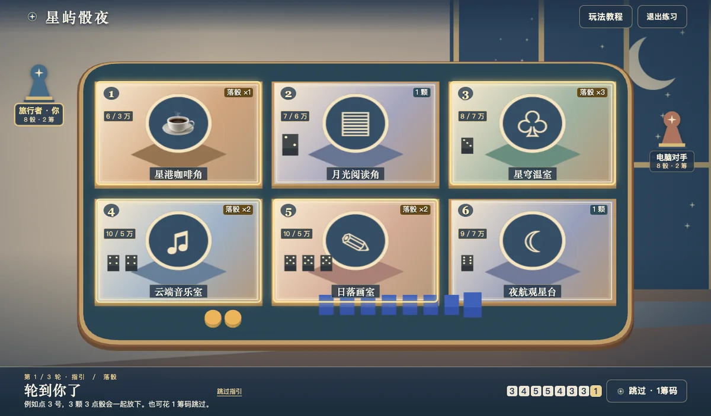
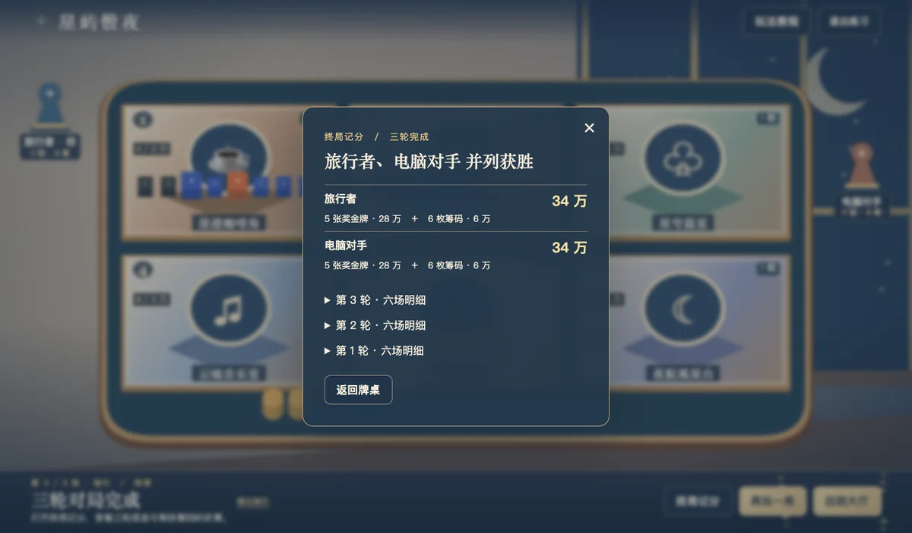

# 星屿骰夜

桌边有六个场地，每个都亮着两张奖金牌。你掷出手里的骰子，挑一个点数，把这一组全押在对应场地。骰子最多也未必能得分：如果另一位玩家的实力恰好与你相同，你们都会让出这个场地的名次。三轮之后，靠奖金与剩余筹码决出赢家。这里的奖金和筹码只用于桌游计分，不涉及真实金钱。


《星屿骰夜》的灵感来自 Rüdiger Dorn 设计的 2012 年《Las Vegas》和 alea / Ravensburger 在 2019 年推出的《Las Vegas Royale》。本作使用 Royale 基础规则和双人变体，把六个场地改成咖啡角、书屋、温室等星屿小景，加上 AI 娘主题席位、可点选的三维牌桌、电脑陪练和桌边教学。这里展示的是公开版的程序绘制美术；角色插画版使用单独保存在本机的美术包。[官方规则书](https://product-files.ravensburger.cloud/manuals/664467.pdf) · [出版方介绍](https://myconvento.com/public/newsroom/data/plugin/images/run/show_media/media_id/2991399/lang/25/id/634/integration/js)

## 三步开玩

1. 在已启动服务的电脑上打开[游戏大厅](http://127.0.0.1:4321/)。第一次玩可以先点「玩法教程」，也可直接从牌桌跟着提示走。
2. **一个人**点「单人派对」，电脑会自动入座，双方打完整三轮。**和朋友一起**选「开一桌」，其他席位点「凭码入座」。全员准备后房主开局。派对桌六场都有小游戏，落骰后就玩，奖罚当场进账。仓库默认服务仅在本机运行，可用普通窗口和隐私窗口体验两个真人席位。
3. 轮到你就掷骰，点一个亮起的场地放置全部同点骰。比如三个 4 可以一齐进 4 号场地；想保留手骰，就花一枚筹码跳过。前两轮结束可看分账、继续下一轮，第三轮自动打开总记分。



## 谁能拿到奖金？

大骰算两点实力，小骰算一点。每场先剔除全部同实力阵营，剩余第一、第二名分别领取较大和较小的牌。两人桌的中立骰也会竞争；它赢走的牌送回牌堆。三轮结束时，每枚剩余筹码计 1 万。总额相同再比奖金牌张数加筹码数，仍相同便一同获胜。



## 可以玩到哪里？

- 支持 2–5 个真人席位或一人对电脑，完整三轮、轮间换先手、逐场分账及并列终局。刷新后可在原服务进程中恢复席位。
- **16 面全部可玩**。随机三板每轮重新抽板；自选桌可固定最多六块。想先试某一面，在「自选扩展」点「单练选中板面」即可。
- **小游戏当场结算**。例如点盲盒场，你的对手先秘密分盒，你看两盒各有几枚，选一盒当场揭晓。点失运场则立刻比较谁落后、谁付罚款。主场的两张奖金牌继续按轮末实力发。这是本作的即时派对改编。
- 线上首轮由房主先手。之后从 6 号场地往下找领牌玩家；若头奖归了中立或灰骰，先看同场第二张。整轮无人领牌时由上轮先手的下一席开始。
- 真人对局和电脑陪练共用同一套服务端规则，电脑不需要外部 AI 服务。尚无公网大厅和服务器重启后的存档恢复。

## 在自己的电脑上启动

安装 Node 22.12 或更新版本，在仓库根目录执行：

```sh
cd games/xingyu-dice-night
npm ci
npm run build
npm start
```

[游戏目录与开发说明](games/xingyu-dice-night/README.md) 包含自动测试命令、端口、规则边界和自有美术的接入方式。
